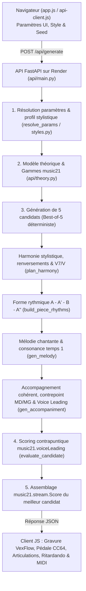
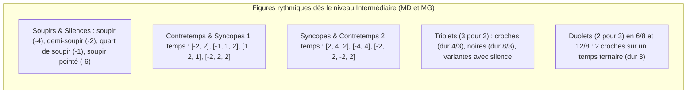
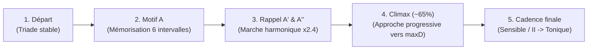

# 🎹 Algorithme de Génération Musicale de Partitio

Ce document détaille l'architecture et les règles de composition musicale pianistique de **Partitio**, propulsé par une **API Python basée sur `music21` et FastAPI** (`api/`) exposée sur **Render**, et consommée par le client navigateur JavaScript (`docs/js/`).

---

## 🧭 Vue d'ensemble de l'architecture et du pipeline

La génération suit une architecture **Client / Serveur** avec sélection **Generate & Rank (Best-of-5)** :
- Le navigateur (`docs/js/app.js` + `docs/js/api-client.js`) envoie les réglages pédagogiques (incluant le **style musical**) et la graine (`seed`) via `POST /api/generate`.
- L'API Python (`api/main.py`, `api/styles.py`, `api/theory.py`, `api/generator.py`) génère **5 partitions candidates déterministes** à partir de sous-graines dérivées de `seed`, évalue leur qualité contrapuntique et mélodique via `music21.voiceLeading`, retient la meilleure, assemble l'objet `music21.stream.Score` final et renvoie le JSON au navigateur.

---

## 1. Représentation des données musicales (`api/theory.py`)

### 1.1 Le degré diatonique absolu ($D$) et `music21.pitch.Pitch`
Chaque hauteur est représentée par son **degré diatonique absolu $D$** et son altération (`alter`), convertis en objets `music21.pitch.Pitch` :

$$D = \text{octave} \times 7 + \text{indice de lettre} \quad (\text{avec } \text{Do}=0, \text{Ré}=1, \dots, \text{Si}=6)$$

| Note | Octave | Indice lettre | $D$ | MIDI (`Pitch.midi`) |
| :--- | :---: | :---: | :---: | :---: |
| **Do 1** ($C_1$) | 1 | 0 | **7** | 24 |
| **Do 3** ($C_3$) | 3 | 0 | **21** | 48 |
| **Do 4** ($C_4$ - Do central) | 4 | 0 | **28** | 60 |
| **La 4** ($A_4$) | 4 | 5 | **33** | 69 |
| **Do 5** ($C_5$) | 5 | 0 | **35** | 72 |

- Les 30 tonalités (15 majeures, 15 mineures) et les 4 gammes (`MajorScale`, `MinorScale`, `HarmonicMinorScale`, `MelodicMinorScale`) sont calculées via **`music21.key.Key`** et **`music21.scale`**.
- Le degré $D$ découple la position verticale sur la portée VexFlow de l'altération (`-2` à `+2`), simplifie les mouvements conjoints ($|D_2 - D_1| = 1$) et garantit le contrôle anatomique de la main ($\le 8$ degrés).

### 1.2 Unités de durée et N-olets (Triolets / Duolets)
Les durées sont exprimées en **unités de double-croche** (**1 noire = 4 unités**, soit `quarterLength = nd / 4` dans `music21`) :

| Figure | Unités (`dur`) | `quarterLength` (`music21`) |
| :--- | :---: | :---: |
| Double-croche | 1 | `1/4` |
| Croche | 2 | `1/2` |
| Croche pointée | 3 | `3/4` |
| Noire | 4 | `1` |
| Noire pointée | 6 | `3/2` |
| Blanche | 8 | `2` |
| Blanche pointée | 12 | `3` |
| Ronde | 16 | `4` |

Pour les **N-olets**, chaque événement distingue :
- `dur` : durée réelle en unités (`4/3` pour une croche de triolet, `8/3` pour une noire de triolet, `3` pour une croche de duolet en 6/8 ou 12/8).
- `notationDur` : figure écrite (`2` croche, `4` noire).
- `tuplet` : `{ id, num, occupied }`, converti en `music21.duration.Tuplet(num, occupied)` côté Python et tracé via `VF.Tuplet` côté VexFlow.

---

## 2. Profils stylistiques & Paramètres (`api/styles.py` & `resolve_params`)

L'utilisateur peut choisir un **style musical** (ou *Automatique* / *Aléa*). Chaque profil influence les grilles harmoniques, la main gauche, les mouvements conjoints, les dominantes secondaires, les renversements et la pédale :

| Style | Grilles caractéristiques | Accompagnements favoris | Dominantes sec. | Renversements | Pédale CC 64 |
| :--- | :--- | :--- | :---: | :---: | :---: |
| **Classique (Mozart)** | `I–IV–V–I`, `I–ii–V–I`, `I–vi–ii–V` | Alberti, Stride, Arpège, Valse | 25 % | 35 % | Oui |
| **Baroque (Bach)** | Marche de quintes, `I–IV–ii–V` | Arpège, Alberti, Triolet, Stride | 32 % | 45 % | Non (clarté) |
| **Romantique (Chopin)** | `I–vi–IV–V`, `i–VI–III–VII`, `I–iii–vi–IV` | Arpège, Triolet, Contretemps, Valse | 30 % | 40 % | Oui |
| **Pop / Jazz** | `I–V–vi–IV`, `vi–IV–I–V`, `ii–V–I–vi` | Syncope `[2,4,2]`, Contretemps, Arpège | 15 % | 25 % | Oui |

Les 5 niveaux de difficulté filtrent en parallèle l'armure maximale, les chiffrages admis, les extensions d'accords et le tempo :

| Niveau | Armure max | Chiffrages admis | Accords enrichis (`auto`) | BPM par défaut |
| :--- | :---: | :---: | :---: | :---: |
| **1. Initiation (5 doigts)** | $\le 1$ altération | 4/4, 3/4 | Triades simples | 60 - 80 |
| **2. Débutant** | $\le 2$ altérations | 4/4, 3/4, 2/4 | $V_7$ discret (MG) | 72 - 96 |
| **3. Intermédiaire** | $\le 4$ altérations | 4/4, 3/4, 2/4, 6/8, 2/2 | 7e / add9 (MD + MG) | 88 - 120 |
| **4. Avancé** | $\le 7$ altérations | Tous chiffrages | 9e / sus4 / add9 | 100 - 144 |
| **5. Virtuose** | $\le 7$ altérations | Tous chiffrages | 9e / 11e / 13e / sus4 | 112 - 160 |

---

## 3. Harmonie expressive via `music21` (`plan_harmony`)

1. **Grilles idiomatiques & cadences** :
   - Mesure 1 : tonique obligatoire ($I$).
   - Demi-cadence médiane ($\ge 4$ mesures) : suspension sur la dominante ($V$ / $V_7$).
   - Cadence finale préparée : pré-dominante ($ii$ ou $IV$) $\to$ dominante ($V$ / $V_7$ / $V_9$) $\to$ tonique conclusive ($I$).
   - Mesures intermédiaires guidées à 70 % par une progression idiomatique du style choisi, complétée par des transitions pondérées sans répétition statique.
2. **Dominantes secondaires (`music21.roman.RomanNumeral`)** :
   - En niveaux *Avancé* et *Virtuose*, des accords **`V7/V`** (avant $V$) et **`V7/vi`** (avant $vi$ en majeur) sont calculés via `music21.roman.RomanNumeral`.
   - Leurs altérations chromatiques exactes (`chromaticAlters`) sont propagées sur le slot afin que la mélodie et la main gauche jouent toutes deux la note altérée juste (ex. Fa♯ sur `V7/V` en Do majeur).
3. **Renversements de basse conjoints (`bassDegree`)** :
   - Dès le niveau *Intermédiaire*, un accord peut être placé en **1er renversement** (tierce à la basse) lorsque cette tierce relie conjointement la basse précédente ou suivante (ex. `I → V6 → vi` : Do → Si → La).

---

## 4. Forme musicale `A – A' – B – A''` & Complexité rythmique (`build_piece_rhythms`)

### 4.1 Structure thématique
Pour donner une vraie cohérence formelle aux pièces ($\ge 4$ mesures), les mesures sont découpées en sections (`section_of_measure`) :
- **Section `A`** (mesures 1–2) : exposition du motif rythmique et mélodique.
- **Section `A'`** (mesures 3–4) : rappel rythmique du motif `A` (65 % de probabilité) menant à la demi-cadence.
- **Section `B`** (mesures 5–6) : phrase contrastante (nouveau rythme et variante d'accompagnement MG).
- **Section `A''`** (mesures 7–8) : retour du thème `A` (75 % de probabilité) résolu par la cadence finale.

### 4.2 Enrichissements rythmiques dès le niveau Intermédiaire

- Garde-fous : aucune mesure ne peut être entièrement silencieuse, le 1er temps de la mesure 1 n'est jamais un silence complet, et la dernière mesure conclut sur une valeur longue tenue.

---

## 5. Mélodie chantante & Consonance stricte (`gen_melody`)

- **Consonance stricte en début de mesure** : sur `ev.start == 0` et `i == 0`, la mélodie impose une note de la **triade consonante** de l'accord courant (lorsqu'elle existe dans l'ambitus), garantissant l'absence de dissonances brutales entre clef de fa et clef de sol sur les temps forts.
- **`pick_consonant_idx`** : le climax (`maxD`) et le creux (`minD`) sont positionnés sur une mesure dont la triade contient cette note.
- **Rappel motivique (`theme_intervals`)** : les 6 premiers intervalles du thème `A` reçoivent un bonus (`×2.4`) en début des sections `A'` et `A''`, créant des marches harmoniques naturelles.
- **Conduite mélodique** : biais de mouvements conjoints modulé par le style (`step_bias`), règle du saut compensé (`×3.5` en sens inverse après un saut $\ge 3$), pénalisation des sauts de triton et de 7e, mineur mélodique ascendant/descendant et respect des `chromaticAlters` des dominantes secondaires.

---

## 6. Accompagnement cohérent, Contrepoint rythmique & Voice Leading (`gen_accompaniment`)

1. **Un style cohérent par section** : au lieu de changer aléatoirement à chaque accord, le générateur choisit **1 style principal pour `A` / `A'` / `A''`** (ex. *Alberti*, *Arpège*, *Contretemps*, *Syncope `[2,4,2]`*, *Triolet d'arpège*, *Valse*, *Barcarolle / Duolet*) et **1 variante cohérente pour `B`**.
2. **Complémentarité rythmique MD / MG (`_slot_treble_stats`)** :
   - Lorsque la densité mélodique de la main droite est élevée (`>= 2.6` notes par temps), la main gauche s'allège automatiquement (basse + accord posé) pour éviter toute surcharge.
   - Lorsque la main droite tient des notes longues, la main gauche déploie pleinement son motif d'accompagnement.
3. **Mouvement contraire & Voice Leading** :
   - La ligne de basse (`r`) intègre un léger biais en sens opposé à la direction de la mélodie (`contrary_shift`) tout en respectant les renversements `bassDegree` et l'ancrage organique de `minD`.
   - Les voicings médiums (`upper`) sélectionnent le renversement le plus proche de l'accord précédent (`closest_octave`) en respectant strictement la limite anatomique d'une octave ($\le 8$ degrés).

---

## 7. Sélection « Generate & Rank » (Best-of-5) & Post-traitement

### 7.1 Évaluation contrapuntique via `music21.voiceLeading` (`evaluate_candidate`)
Pour chaque requête, 5 candidats déterministes sont générés et notés à partir d'un score de base de `100` :
- **Quintes et octaves parallèles** entre basse et soprano aux changements de mesure (détectées par `music21.voiceLeading.VoiceLeadingQuartet`) : **`-25` points** par faute.
- **Mouvement contraire** basse / soprano : **`+6` points** par transition.
- **Équilibre mouvements conjoints / sauts** : pénalité proportionnelle à l'écart par rapport à une cible de 65 % de mouvements conjoints ; pénalité supplémentaire si plus de 25 % des intervalles sont des répétitions.

### 7.2 Garanties strictes et assemblage `music21.stream.Score`
1. **Clamping strict d'ambitus** : toute note hors $[minD, maxD]$ est transposée par octave ($\pm 7$).
2. **Garantie d'extremums consonants (`pick_extremum_event`)** : `minD` et `maxD` apparaissent toujours sur un événement consonant avec l'accord (et en basse sur le 1er temps, uniquement s'il s'agit de la basse de l'accord), en maintenant l'écartement d'une main $\le 8$ degrés.
3. **Assemblage `music21.stream.Score`** : `build_music21_score` construit la partition complète `music21` (`Part`, `Measure`, `Clef`, `Key`, `TimeSignature`, `MetronomeMark`, `Note`, `Chord`, `Rest`, `Tuplet`).

---

## 8. Interprétation, Pédale de Sustain & Rendu Client (`docs/js/`)

Côté navigateur, l'interprétation audio (Web Audio & Web MIDI) et l'export `.mid` enrichissent la partition brute :
- **Arche dynamique & balance des voix** (`docs/js/events.js`) : léger *crescendo* vers le milieu de la pièce puis détente cadentielle, mise en relief de la voix supérieure dans les accords (`+4` soprano / `-4` voix intérieures), notes tenues chantantes (`+4`) et notes de passage plus légères (`-5`).
- **Articulations (`gateRatio`)** : legato (`0.96`) sur la mélodie, légèrement détaché (`0.74`) sur les accords d'accompagnement répétés en valse/stride/contretemps, fluide (`0.92`) sur les arpèges.
- **Pédale de sustain automatique (`buildPedalEvents`, MIDI CC 64)** : relâchement (`0`) et enfoncement (`127`) synchronisés sur chaque changement d'accord, transmis en Web MIDI (`docs/js/midi.js`), gravés dans l'export `.mid` (`docs/js/midi-file.js`), et simulés par une résonance prolongée sur le synthétiseur interne (`docs/js/player.js`). Désactivée en style *Baroque* et niveau *Initiation*.
- **Humanisation & *ritardando* final** : micro-décalage organique déterministe (`±6 ms`) et léger ralentissement progressif sur la dernière mesure.

---

## 9. Synthèse des fichiers sources

| Fichier | Rôle clé |
| :--- | :--- |
| `api/main.py` | API FastAPI (`GET /api/health`, `POST /api/generate`), CORS et service statique de `docs/` pour Render. |
| `api/styles.py` | Profils stylistiques (*Classique*, *Baroque*, *Romantique*, *Pop / Jazz*) : grilles, accompagnements, taux de renversements et dominantes secondaires. |
| `api/generator.py` | Moteur `music21` : forme `A–A'–B–A''`, dominantes secondaires (`RomanNumeral`), renversements, contrepoint MD/MG, Voice Leading, Best-of-5 (`VoiceLeadingQuartet`) et `build_music21_score`. |
| `api/theory.py` | Tonalités, gammes majeures/mineures et conversions hauteurs/MIDI via `music21`. |
| `render.yaml` | Blueprint de déploiement Python sur Render (`requirements.txt`, `uvicorn`). |
| `docs/js/api-client.js` | Client `fetch` appelant `POST /api/generate` sur le backend Render / local. |
| `docs/js/config.js` | Configuration de l'URL de l'API Render (`DEFAULT_API_URL`). |
| `docs/js/app.js` | Interface utilisateur, sélecteur de style, gestion asynchrone (`AbortController`) et cycle de vie. |
| `docs/js/events.js` | Dynamique de phrase, articulations (`gateRatio`), micro-humanisation et pédale de sustain (`buildPedalEvents`). |
| `docs/js/renderer.js` | Gravure SVG VexFlow (clés, armures, ligatures, `VF.Tuplet`, surlignage temps réel). |
| `docs/js/midi.js` & `midi-file.js` | Sortie Web MIDI temps réel et export `.mid` avec support N-olets et pédale CC 64. |
| `docs/js/player.js` | Séquenceur Web Audio / Web MIDI avec *ritardando* final, pédale et synchronisation visuelle. |
