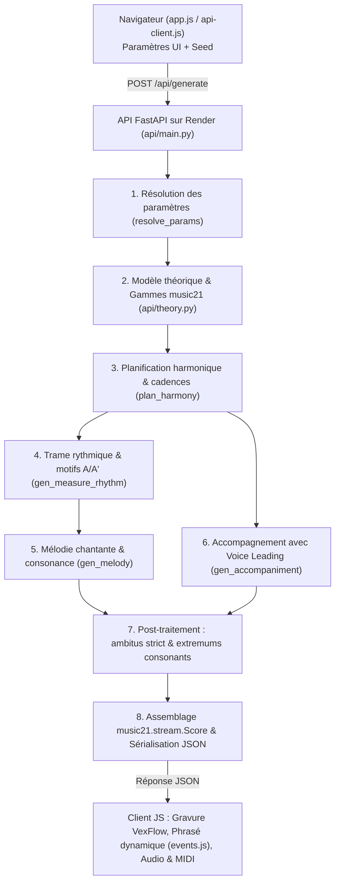
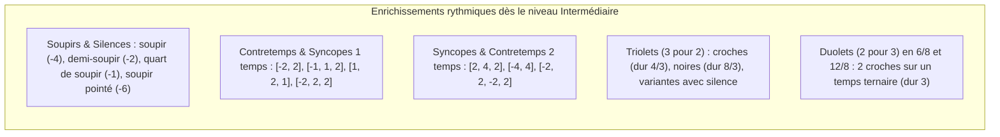
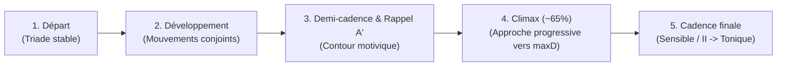
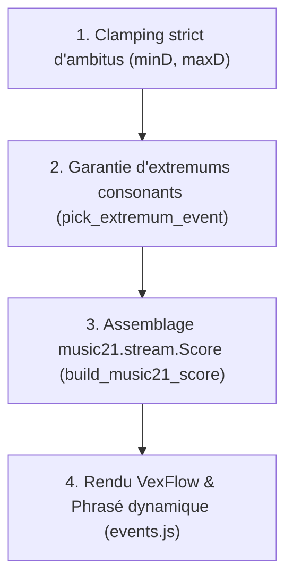

# 🎹 Algorithme de Génération Musicale de Partitio

Ce document détaille l'architecture et l'algorithme de composition musicale pianistique de **Partitio**, désormais propulsé par une **API Python basée sur `music21` et FastAPI** (`api/`) exposée sur **Render**, et consommée par le client navigateur JavaScript (`docs/js/`).

---

## 🧭 Vue d'ensemble de l'architecture et du pipeline

La génération suit une architecture **Client / Serveur** :
- Le navigateur (`docs/js/app.js` + `docs/js/api-client.js`) envoie les réglages pédagogiques et la graine (`seed`) via `POST /api/generate`.
- L'API Python (`api/main.py`, `api/theory.py`, `api/generator.py`) compose la pièce de façon **déterministe** (reproductible à l'identique à partir de la même graine), assemble un objet `music21.stream.Score`, et renvoie la partition JSON consommée par VexFlow, le synthétiseur Web Audio, la sortie Web MIDI et l'export `.mid`.

---

## 1. Représentation des données musicales (`api/theory.py`)

### 1.1 Le degré diatonique absolu ($D$) et `music21.pitch.Pitch`
Une hauteur est représentée conjointement par son **degré diatonique absolu $D$** et son altération (`alter`), convertis en objets `music21.pitch.Pitch` :

$$D = \text{octave} \times 7 + \text{indice de lettre} \quad (\text{avec } \text{Do}=0, \text{Ré}=1, \dots, \text{Si}=6)$$

| Note | Octave | Indice lettre | $D$ | MIDI (`Pitch.midi`) |
| :--- | :---: | :---: | :---: | :---: |
| **Do 1** ($C_1$) | 1 | 0 | **7** | 24 |
| **Do 3** ($C_3$) | 3 | 0 | **21** | 48 |
| **Do 4** ($C_4$ - Do central) | 4 | 0 | **28** | 60 |
| **La 4** ($A_4$) | 4 | 5 | **33** | 69 |
| **Do 5** ($C_5$) | 5 | 0 | **35** | 72 |

**Avantages :**
- Les 30 tonalités (15 majeures, 15 mineures) et les 4 gammes (`MajorScale`, `MinorScale`, `HarmonicMinorScale`, `MelodicMinorScale`) sont calculées directement via **`music21.key.Key`** et **`music21.scale`**.
- Le degré $D$ sépare la position verticale sur la portée (VexFlow) de l'altération accidentelle (`-2` à `+2`) et permet de mesurer instantanément les mouvements conjoints ($|D_2 - D_1| = 1$) et l'écartement anatomique de la main ($\le 8$ degrés).

### 1.2 Unités de durée et N-olets (Triolets / Duolets)
Les durées de base sont exprimées en **unités de double-croche** (**1 noire = 4 unités**, soit `quarterLength = nd / 4` dans `music21`) :

| Figure | Unités (`dur`) | `quarterLength` (`music21`) |
| :--- | :---: | :---: |
| Double-croche | 1 | `1/4` |
| Croche | 2 | `1/2` |
| Croche pointée | 3 | `3/4` |
| Noire | 4 | `1` |
| Noire pointée | 6 | `3/2` |
| Blanche | 8 | `2` |
| Blanche pointée | 12 | `3` |
| Ronde | 16 | `4` |

Pour les **N-olets**, chaque événement distingue :
- `dur` : la durée de jeu réelle en unités (ex. `4/3` pour une croche de triolet, `8/3` pour une noire de triolet, `3` pour une croche de duolet en 6/8 ou 12/8).
- `notationDur` : la figure écrite sur la portée (`2` pour une croche, `4` pour une noire).
- `tuplet` : `{ id, num, occupied }` converti en `music21.duration.Tuplet(num, occupied)` côté Python et tracé via `VF.Tuplet` côté VexFlow.

### 1.3 Reproductibilité (`SeededRng`)
`SeededRng(seed)` encapsule `random.Random(seed & 0xFFFFFFFF)` et fournit des tirages uniformes, pondérés (`weighted`) et probabilistes (`chance`) garantissant une partition identique à graine et réglages égaux.

---

## 2. Résolution des paramètres (`resolve_params`)

Résout les cases aléatoires (🎲) et filtre tonalités, chiffrages, tempi et enrichissements selon les **5 niveaux** :

| Niveau | Armure max | Chiffrages admis | Accords enrichis (`auto`) | BPM par défaut |
| :--- | :---: | :---: | :---: | :---: |
| **1. Initiation (5 doigts)** | $\le 1$ altération | 4/4, 3/4 | Triades simples | 60 - 80 |
| **2. Débutant** | $\le 2$ altérations | 4/4, 3/4, 2/4 | $V_7$ discret (MG) | 72 - 96 |
| **3. Intermédiaire** | $\le 4$ altérations | 4/4, 3/4, 2/4, 6/8, 2/2 | 7e / add9 (MD + MG) | 88 - 120 |
| **4. Avancé** | $\le 7$ altérations | Tous chiffrages | 9e / sus4 / add9 | 100 - 144 |
| **5. Virtuose** | $\le 7$ altérations | Tous chiffrages | 9e / 11e / 13e / sus4 | 112 - 160 |

---

## 3. Planification harmonique & cadences (`plan_harmony`)

L'algorithme construit la grille harmonique par *slots* (1 mesure complète, ou 2 demi-mesures en 4 temps dès le niveau *Intermédiaire*) :

1. **Mesure 1** : Tonique obligatoire ($I$).
2. **Demi-cadence médiane** ($\ge 4$ mesures) : suspension sur la dominante ($V$ ou $V_7$) en fin de première moitié.
3. **Cadence finale préparée** : pré-dominante ($ii$ ou $IV$) $\to$ dominante ($V$ / $V_7$ / $V_9$) $\to$ tonique conclusive ($I$).
4. **Enchaînements fluides** : matrice de transitions pondérées évitant les répétitions statiques d'un même accord sur deux slots consécutifs.
5. **Extensions** : 7e, 9e, `sus4` et `add9` appliqués selon le niveau et le mode d'enrichissement choisi.

---

## 4. Trame rythmique complexe (`gen_measure_rhythm`)

Les niveaux **Initiation** et **Débutant** restent sur des valeurs simples et stables. Dès le niveau **Intermédiaire** (et de façon accrue en **Avancé** et **Virtuose**), le moteur introduit des figures rythmiques avancées :

- **Garde-fous musicaux** : la première mesure ne démarre pas par un silence complet sur le 1er temps, aucune mesure ne peut être intégralement silencieuse, et la dernière mesure reste une valeur longue conclusive.
- **Cohérence motivique (A / A')** : pour les pièces $\ge 6$ mesures, le début de la seconde moitié (`m = n // 2`) rappelle dans 45 % des cas le motif rythmique de la mesure 1.

---

## 5. Mélodie chantante & Consonance (`gen_melody`)

### 5.1 Tessiture, profil en arc et climax consonant
L'ambitus $[minD, maxD]$ est partagé autour d'un pivot ($minD + 0.45 \times (maxD - minD)$) entre la main gauche et la main droite.

- **`pick_consonant_idx`** : au lieu de forcer `maxD` (ou `minD`) sur un indice arbitraire, l'algorithme choisit l'emplacement proche de 65 % (ou 25 %) où cette note appartient à la **triade de l'accord courant**, évitant toute dissonance forcée.
- **Consonance stricte en début de mesure** : sur le 1er temps de chaque mesure (`ev.start == 0`) ainsi que sur la toute première note (`i == 0`), la mélodie impose une note de la **triade consonante** de l'accord (fondamentale, tierce ou quinte) lorsqu'elle est disponible dans l'ambitus.

### 5.2 Conduite mélodique et règles contrapuntiques
- **Pondération des intervalles** (`INTERVAL_WEIGHTS`) privilégiant les mouvements conjoints.
- **Règle du saut compensé** : un saut $\ge 3$ degrés est suivi préférentiellement d'un mouvement conjoint en sens inverse.
- **Évitement des dissonances mélodiques** : pénalisation forte des sauts de triton (degrés $3 \leftrightarrow 6$) et des sauts de 7e ; interdiction de 3 notes identiques consécutives.
- **Rappel motivique (A')** : mémorisation des 4 premiers intervalles du thème (`theme_intervals`) et bonus de probabilité en début de seconde phrase.
- **Mineur mélodique** : 6e et 7e degrés haussés à la montée ou près de la sensible, naturels à la descente.
- **Harmonisation MD** : ajout éventuel de 1 à 2 notes d'accord sous le chant dans un écart maximal de 7 degrés.

---

## 6. Accompagnement pianistique & Voice Leading (`gen_accompaniment`)

### 6.1 Conduite des voix (*Voice Leading*)
Au lieu de replacer chaque accord en position fondamentale fixe, la main gauche sélectionne pour chaque changement d'accord :
- le **renversement des voix médiums (`upper`) le plus proche** du centre de l'accord précédent (`closest_octave`), favorisant les notes communes et les mouvements conjoints ;
- une **ligne de basse fluide** (`r`) vers l'octave la plus proche de la basse précédente, tout en ancrant `minD` uniquement sur un slot dont la fondamentale correspond réellement à sa lettre (évitant tout faux accord en mesure 1) ;
- la **règle anatomique stricte** : aucun accord plaqué d'une seule main ne dépasse 8 degrés (une octave).

### 6.2 Styles pianistiques et complexité rythmique MG
Dès le niveau **Intermédiaire**, la main gauche bénéficie elle aussi des enrichissements rythmiques :
- **Valse (`3/4`)** : valse classique, valse avec **contretemps** (demi-soupir + accord), et **triolets d'arpèges** en *Avancé / Virtuose*.
- **Trois croches (`3/8`)** : accompagnement régulier ou contretemps avec demi-soupir.
- **Mesures composées (`6/8`, `12/8`)** : arpèges balancés, **duolets de croches** (`2 pour 3`) et contretemps ternaires avec silence.
- **Mesures binaires (`4/4`, `2/4`, `2/2`, `5/4`)** :
  - *Initiation / Débutant* : fondamentales tenues, quintes ouvertes ou noires régulières.
  - *Intermédiaire* : basse d'Alberti, stride, **contretemps avec demi-soupirs** et **triolets d'arpège**.
  - *Avancé / Virtuose* : arpèges enrichis (7e/9e), **syncopes `[2, 4, 2]`**, contretemps et **triolets de croches** (incluant des triolets avec silence en *Virtuose*).

---

## 7. Post-traitement, `music21.stream.Score` & Phrasé dynamique

1. **Clamping strict d'ambitus** : toute note hors $[minD, maxD]$ est ramenée par translation d'octave ($\pm 7$).
2. **Garantie d'apparition de `minD` et `maxD` sans dissonance** (`pick_extremum_event`) : si une borne n'apparaît pas encore, le moteur choisit en priorité un événement dont l'accord contient cette note (et en basse sur le 1er temps, uniquement la fondamentale), en préservant l'écartement maximal d'une main ($\le 8$ degrés).
3. **Construction `music21.stream.Score`** : `build_music21_score` génère les `Part` (`RightHand`, `LeftHand`), `Measure`, clés, armures, chiffrages, `MetronomeMark`, `Note`, `Chord`, `Rest` et `Tuplet`.
4. **Phrasé dynamique côté client (`docs/js/events.js`)** :
   - **Arche dynamique** en sinus sur la pièce (léger *crescendo* vers le milieu puis détente cadentielle).
   - Mise en relief de la voix supérieure dans les accords (`+4` sur le soprano, `-4` sur les voix intérieures), notes tenues chantantes (`+4`) et notes rapides de passage plus légères (`-5`).
   - Arrondi exact des ticks MIDI (`Math.round`) dans `docs/js/midi-file.js` pour une lecture fidèle des triolets et duolets.

---

## 8. Synthèse des fichiers sources

| Fichier | Rôle clé |
| :--- | :--- |
| `api/main.py` | API FastAPI (`GET /api/health`, `POST /api/generate`), CORS et service statique de `docs/` pour Render. |
| `api/generator.py` | Moteur de composition Python basé sur `music21` (`plan_harmony`, `gen_measure_rhythm`, `gen_melody`, `gen_accompaniment`, `build_music21_score`, `generate_score`). |
| `api/theory.py` | Tonalités, gammes majeures/mineures et conversions hauteurs/MIDI via `music21`. |
| `render.yaml` | Blueprint de déploiement Python sur Render (`requirements.txt`, `uvicorn`). |
| `docs/js/api-client.js` | Client `fetch` appelant `POST /api/generate` sur le backend Render / local. |
| `docs/js/config.js` | Configuration de l'URL de l'API Render (`DEFAULT_API_URL`). |
| `docs/js/app.js` | Interface utilisateur, gestion asynchrone (`AbortController`) et cycle de vie. |
| `docs/js/events.js` | Conversion de la partition en événements audio/MIDI avec phrasé dynamique expressif. |
| `docs/js/renderer.js` | Gravure SVG VexFlow (clés, armures, ligatures, `VF.Tuplet`, surlignage temps réel). |
| `docs/js/midi-file.js` | Export Standard MIDI File (`.mid`) avec arrondi de ticks compatible N-olets. |
| `docs/js/player.js` | Séquenceur temps réel Web Audio / Web MIDI et synchronisation visuelle. |
