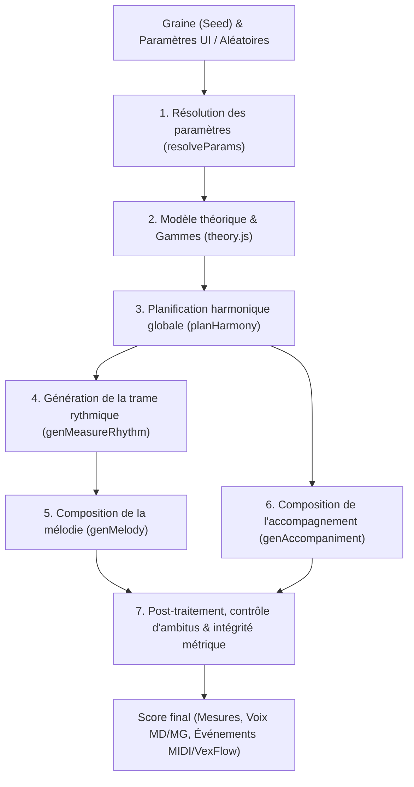
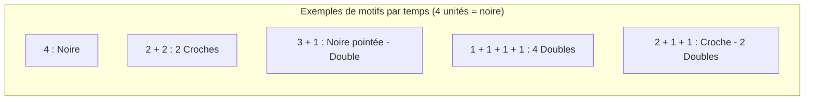
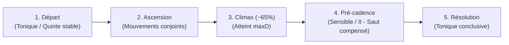
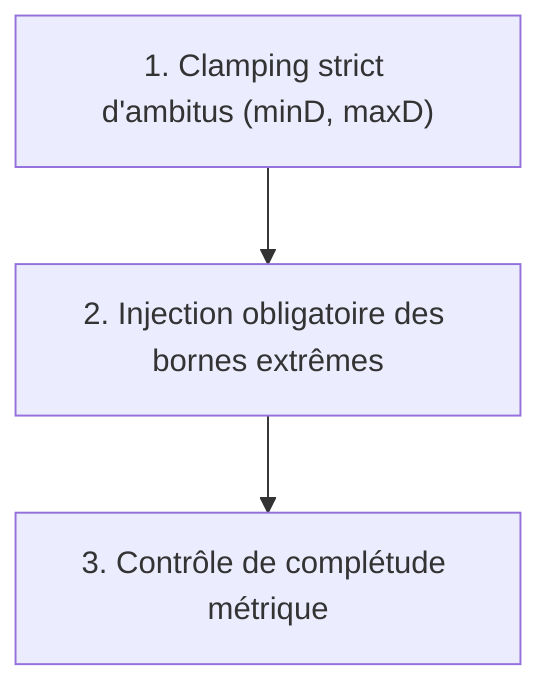

# 🎹 Algorithme de Génération Musicale de Partitio

Ce document détaille le fonctionnement complet de l'algorithme de composition musicale pianistique implémenté dans Partitio (`docs/js/generator.js`, `docs/js/theory.js`, `docs/js/rng.js`).

---

## 🧭 Vue d'ensemble du pipeline de génération

L'algorithme adopte une approche **stochastique à base de règles harmoniques, contrapuntiques et anatomiques pianistiques**. Il produit une partition déterministe (reproductible à l'identique à partir d'une graine / `seed`) adaptée au niveau pédagogique de l'élève.



---

## 1. Représentation des données musicales

### 1.1 Le degré diatonique absolu ($D$)
Dans `theory.js`, une note n'est pas simplement un code MIDI chromatique. Elle est représentée par son **degré diatonique absolu $D$** :

$$D = \text{octave} \times 7 + \text{indice de lettre} \quad (\text{avec } \text{Do}=0, \text{Ré}=1, \dots, \text{Si}=6)$$

| Note | Octave | Indice lettre | $D$ | MIDI (hauteur naturelle) |
| :--- | :---: | :---: | :---: | :---: |
| **Do 1** ($C_1$) | 1 | 0 | **7** | 24 |
| **Do 3** ($C_3$) | 3 | 0 | **21** | 48 |
| **Do 4** ($C_4$ - Do central) | 4 | 0 | **28** | 60 |
| **La 4** ($A_4$) | 4 | 5 | **33** | 69 |
| **Do 5** ($C_5$) | 5 | 0 | **35** | 72 |

**Avantages musicaux de cette représentation :**
- **Calcul naturel des mouvements conjoints / disjoints** : un intervalle de seconde diatonique correspond exactement à $|D_2 - D_1| = 1$.
- **Découplage de la portée et des altérations** : la position d'une note sur la portée VexFlow dépend uniquement de $D$. L'altération (dièse $\sharp$, bémol $\flat$, bécarre $\natural$) est stockée séparément (`alter: -1, 0, 1`).
- **Calcul universel de la hauteur MIDI** :
  $$\text{MIDI} = \text{octave} \times 12 + \text{naturalPC}[\text{lettre}] + \text{alter} + 12$$

### 1.2 Unités de durée discrètes
Pour éliminer tout problème d'arrondi à virgule flottante, les durées sont exprimées en unités entières discrètes où **1 noire = 4 unités** :

| Figure | Symbole | Unités |
| :--- | :---: | :---: |
| Double-croche | 𝅘𝅥𝅯 | 1 |
| Croche | 𝅘𝅥𝅮 | 2 |
| Croche pointée | 𝅘𝅥𝅮. | 3 |
| Noire | 𝅘𝅥 | 4 |
| Noire pointée | 𝅘𝅥. | 6 |
| Blanche | 𝅗𝅥 | 8 |
| Blanche pointée | 𝅗𝅥. | 12 |
| Ronde | 𝅝 | 16 |

Une mesure en **4/4** compte 16 unités ; en **3/4**, 12 unités ; en **6/8**, 12 unités (2 temps ternaires de 6 unités) ; en **2/4**, 8 unités.

### 1.3 Générateur pseudo-aléatoire (`rng.js`)
L'algorithme utilise un PRNG déterministe basé sur une graine hexadécimale (`seed`). Il fournit des tirages uniformes, pondérés (`rng.weighted(weights)`) et des tests probabilistes (`rng.chance(prob)`).

---

## 2. Résolution des paramètres (`resolveParams`)

La fonction `resolveParams` résout les éventuelles cases aléatoires (🎲) et filtre les contraintes selon les **5 niveaux de difficulté** :

| Niveau | Armure max | Chiffrages admis | Chords enrichis | BPM par défaut |
| :--- | :---: | :---: | :---: | :---: |
| **1. Initiation (5 doigts)** | $\le 1$ altération (Do, Sol, Fa) | 4/4, 3/4 | Triades fondamentales | 60 - 80 |
| **2. Débutant** | $\le 2$ altérations | 4/4, 3/4, 2/4 | $V_7$ discret | 72 - 96 |
| **3. Intermédiaire** | $\le 4$ altérations | 4/4, 3/4, 2/4, 6/8, 2/2 | 7e / add9 | 88 - 120 |
| **4. Avancé** | $\le 7$ altérations | Tous chiffrages | 9e / sus4 | 100 - 144 |
| **5. Virtuose** | $\le 7$ altérations | Tous chiffrages | 9e / 11e / 13e | 112 - 160 |

---

## 3. Planification harmonique (`planHarmony`)

Avant de poser la moindre note, l'algorithme construit la **grille harmonique** sous forme de tranches temporelles (*slots*).

### 3.1 Découpage des slots harmoniques
- En temps normal, un accord dure **une mesure complète**.
- Dès le niveau *Intermédiaire* sur les mesures à 4 temps, l'accord peut être scindé en deux accords d'une demi-mesure (2 temps chacun), avec une probabilité croissante (20% en intermédiaire, 35% en avancé, 50% en virtuose).

### 3.2 Degrés harmoniques admis selon le niveau
```
Initiation    : [I, IV, V]
Débutant      : [I, ii, IV, V, vi]
Intermédiaire : [I, ii, IV, V, vi]
Avancé/Expert : [I, ii, iii, IV, V, vi]  (en mineur, le degré iii est écarté pour préserver la clarté tonale)
```

### 3.3 Structure cadentielle classique
L'algorithme impose les règles de la syntaxe harmonique tonale :
1. **Mesure 1** : Tonique obligatoire ($I$) pour poser le cadre tonal.
2. **Dernière mesure** : Tonique conclusive obligatoire ($I$).
3. **Avant-dernière mesure** : Accord de dominante ($V$ ou $V_7$) pour former une cadence parfaite $V \to I$.
4. **Milieu de pièce** ($\ge 4$ mesures) : suspension sur la dominante ($V$) pour créer une **demi-cadence** respiratoire.
5. **Enchaînements intermédiaires** (chaîne de Markov harmonique orientée) :
   - Après $V$ $\to$ résolution vers $I$, ou cadence rompue vers $vi$, ou vers $IV$.
   - Après $ii$ $\to$ préparation de dominante vers $V$.
   - Après $IV$ $\to$ vers $V$, $I$, ou $ii$.
   - Après $vi$ $\to$ vers $ii$, $IV$, ou $V$.

### 3.4 Enrichissements d'accords
Selon les réglages et le niveau, des extensions sont injectées :
- **7e** ($V_7$, $I_{\text{maj}7}$, $ii_7$, $vi_7$) : ajout du 6e degré au-dessus de la fondamentale.
- **9e / add9** : ajout du 1er degré de l'octave supérieure.
- **sus4** : suspension de quarte remplaçant la tierce.

---

## 4. Génération de la trame rythmique (`genMeasureRhythm`)

Le rythme est généré **mesure par mesure et temps par temps (beat-by-beat)** à l'aide de motifs rythmiques pondérés (`BEAT_PATTERNS`).



- **En Initiation** : les temps ne sont constitués que de figures longues (noires isolées ou rondes/blanches sur toute la mesure).
- **En Débutant** : apparition des croches régulières `[2, 2]`.
- **En Intermédiaire** : apparition des rythmes pointés `[3, 1]`.
- **En Avancé et Virtuose** : introduction des doubles-croches `[1, 1, 1, 1]`, `[2, 1, 1]`, `[1, 1, 2]`.
- **Dernière mesure** : décomposition en une seule valeur longue tenue pour garantir une fin d'exercice stable et claire.

---

## 5. Composition de la mélodie chantante (`genMelody`)

La mélodie (main droite, ou main gauche seule) est construite par un parcours probabiliste contraint :

### 5.1 Tessiture et pivot
L'ambitus $[minD, maxD]$ est scindé pour attribuer une zone privilégiée à la main droite :
$$\text{pivot} = \text{arrondi}(minD + (maxD - minD) \times 0.45)$$
La main droite évolue principalement au-dessus du pivot, tout en disposant de toute la plage supérieure jusqu'à $maxD$.

### 5.2 Profil mélodique en arc et Climax
Pour éviter une ligne plate ou erratique, l'algorithme génère un **arc narratif** :
- **Début** : départ sur une note stable de l'accord (fondamentale ou quinte).
- **Montée vers le point culminant (Climax)** : situé aux $\approx 65\%$ de la pièce, le sommet mélodique atteint expressément la note la plus haute choisie ($maxD$).
- **Résolution finale** : l'avant-dernière note privilégie un mouvement conjoint (degré 1 ou 6 de la gamme, sensible ou sus-tonique) se résolvant directement sur la tonique finale.



### 5.3 Pondération des intervalles et conduite des voix
À chaque note, l'intervalle avec la note précédente est choisi selon la matrice `INTERVAL_WEIGHTS` :

- **Préférence forte pour les mouvements conjoints** (intervalles de seconde, poids $\approx 4$ à $8$).
- **Tierces modérées** (poids $\approx 1$ à $3$).
- **Quartes, quintes et octaves rares** (sauts expressifs).
- **Règle du saut compensé** : lorsqu'un saut $\ge 3$ degrés a lieu, la note suivante doit obligatoirement changer de direction par un mouvement conjoint (règle contrapuntique classique).
- **Pas de triple répétition** : il est interdit de répéter 3 fois consécutivement la même note.
- **Temps forts vs temps faibles** : sur les temps forts, les notes réelles de l'accord (`isCT`) reçoivent un bonus de probabilité ; sur temps faibles, les notes de passage diatoniques sont libres.

### 5.4 Traitement du mineur mélodique
Lorsque la tonalité est en **mineur mélodique** :
- Si la mélodie monte ou se dirige vers la sensible haussée, les **6e et 7e degrés sont haussés** (`melodyUp`).
- Si la mélodie descend sans tension vers la sensible, les **6e et 7e degrés redeviennent naturels** (`melodyDown`).

### 5.5 Harmonisation de la main droite
Si l'option d'enrichissement de la main droite est activée :
- Des notes complémentaires d'accords sont injectées **sous le chant** sur les temps forts.
- **Contrainte anatomique stricte** : l'écartement entre la note la plus basse et le chant soprano ne dépasse jamais 7 degrés (une octave), garantissant la parfaite jouabilité d'une seule main.

---

## 6. Composition de l'accompagnement (`genAccompaniment`)

La main gauche utilise des **patterns pianistiques idiomatiques** adaptés à la métrique et au niveau :

### 6.1 Ancrage de la note minimale ($minD$)
L'algorithme identifie le slot harmonique dont la fondamentale correspond à la lettre de $minD$, et y ancre organiquement la basse la plus profonde du morceau.

### 6.2 Styles d'accompagnement selon le mètre et le niveau

#### A. Style Valse classique (mesures en 3/4)
- **Temps 1** : Basse fondamentale jouée seule dans le registre grave.
- **Temps 2 et 3** : Voicings d'accords compacts et sonores dans le registre médium.

#### B. Style Barcarolle / Berceuse (mesures composées en 6/8, 12/8)
- Arpège balancé fluide de 3 croches par temps :
  $$\text{Basse fondamentale (temps 1)} \longrightarrow \text{Tierce / Quinte médium} \longrightarrow \text{Septième / Octave}$$

#### C. Styles Binaires (4/4, 2/4, 2/2)
- **Initiation** : Fondamentale tenue en rondes ou blanches.
- **Débutant** : Quinte ouverte plaquée ($r, r+4$) ou pulsation en noires régulières.
- **Intermédiaire** :
  - **Basse d'Alberti** : motif arpégé brisé classique (*Basse - Quinte - Tierce - Quinte*).
  - **Stride** : Basse sur les temps 1 et 3, accord plaqué sur les temps 2 et 4.
- **Avancé & Virtuose** :
  - Arpèges amples à 4 sons incluant 7es et 9es.
  - Voicings enrichis polyphoniques.

#### D. Cadence finale
- Sur la dernière mesure, l'accompagnement se stabilise en une quinte ouverte noble et résonante ($r, r+4$) ou une fondamentale pleine, permettant à la résonance du piano de clore l'exercice.

---

## 7. Post-traitement et garanties pédagogiques

Avant d'exporter la partition, 3 phases de validation garantissent l'absence d'erreurs :



1. **Clamping strict d'ambitus** :
   Chaque note $D$ est contrôlée. Si un voicing ou un arpège dépasse l'intervalle $[minD, maxD]$, la note est transposée par octaves diatoniques entières ($\pm 7$) jusqu'à réintégrer la plage autorisée, sans jamais altérer son nom de note ni son rôle harmonique.

2. **Garantie de présence de $minD$ et $maxD$** :
   Si un utilisateur spécifie un ambitus restreint (ex. Do2 - Sol5) :
   - L'algorithme vérifie que la note la plus haute de la main droite touche exactement $maxD$. Si ce n'est pas le cas, le pic mélodique est ajusté sur $maxD$.
   - Il vérifie que la basse de la main gauche touche exactement $minD$. Si ce n'est pas le cas, la note la plus grave est calée sur $minD$.

3. **Intégrité métrique absolue** :
   La somme des durées de chaque mesure sur chaque portée est vérifiée pour correspondre au total exact de la mesure ($meter.measureLen$). Aucune mesure ne peut être incomplète ou surchargée.

---

## 8. Synthèse des fichiers sources

| Fichier | Rôle clé |
| :--- | :--- |
| `docs/js/generator.js` | Moteur algorithmique principal (`planHarmony`, `genMelody`, `genAccompaniment`, `generateScore`). |
| `docs/js/theory.js` | Modèle théorique : représentation $D$, 15 tonalités, 4 gammes mineures, calcul d'armures et fréquences MIDI. |
| `docs/js/rng.js` | Générateur pseudo-aléatoire déterministe avec support de graine (`seed`). |
| `docs/js/renderer.js` | Conversion des structures `Score` en notation vectorielle VexFlow (clés, armures, liaisons, hampes). |
| `docs/js/player.js` | Horodatage précis, ordonnancement Web Audio / Web MIDI et surlignage SVG en temps réel. |

