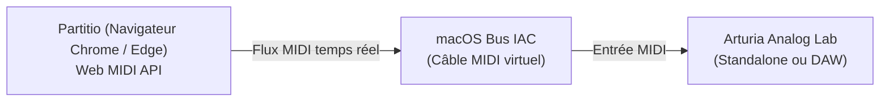

# 🎹 Connexion de Partitio à Arturia Analog Lab via Sortie MIDI

Ce guide explique comment router la sortie MIDI de l'application web **Partitio** vers le synthétiseur virtuel **Arturia Analog Lab** (en version autonome ou via un DAW) sous macOS.

---

## 💡 Principe de fonctionnement

Partitio utilise la **Web MIDI API** pour émettre des événements MIDI en temps réel (Notes On/Off, vélocité, changement de programme, canaux séparés pour main droite et main gauche).

Sous macOS, la communication entre deux logiciels locaux (le navigateur web et Analog Lab) s'effectue via un câble virtuel intégré au système : le **Bus IAC** (*Inter-Application Communication*).

---

## 🛠️ Guide de configuration pas à pas

### Étape 1 : Activer le Bus IAC sous macOS (opération unique)

macOS intègre nativement un pilote de routage MIDI virtuel qu'il suffit d'activer :

1. Ouvrez l'utilitaire **Configuration audio et MIDI** (*Audio MIDI Setup*) :
   - Via Spotlight : appuyez sur `Cmd + Espace`, tapez `Configuration audio et MIDI` puis `Entrée`.
2. Dans la barre de menus supérieure, cliquez sur **Fenêtre** > **Afficher le studio MIDI** (ou utilisez le raccourci `Cmd + 2`).
3. Dans la vue graphique du studio MIDI, double-cliquez sur l'icône rouge intitulée **Bus IAC**.
4. Dans la fenêtre des propriétés :
   - Cochez l'option **« Le périphérique est en ligne »**.
   - Vérifiez qu'un port existe dans la liste inférieure (nommé par défaut `Bus 1` ou `Port 1`). Si la liste est vide, cliquez sur le bouton `+` pour en ajouter un.
5. Cliquez sur **Appliquer** puis fermez la fenêtre.

---

### Étape 2 : Configurer Analog Lab pour écouter le Bus IAC

1. Lancez **Analog Lab** en mode autonome (*Standalone*).
2. Ouvrez le panneau des préférences audio/MIDI :
   - Cliquez sur l'icône du menu principal en haut à gauche (les 3 barres horizontales) > **Audio MIDI Settings** (ou sur l'icône de roue dentée).
3. Dans la section **MIDI Devices** (ou **MIDI Inputs**) :
   - Cochez la case correspondant au **« Bus IAC »** (ou *IAC Driver Bus 1*).
4. Sélectionnez le son ou preset de votre choix (Piano de concert, Rhodes, Synthétiseur, etc.).

> [!TIP]
> **Canaux MIDI dans Partitio :**
> - **Main droite (soprano)** : Canal MIDI 1
> - **Main gauche (basse)** : Canal MIDI 2
> - **Métronome sonore** : Canal MIDI 10 (percussions)
> 
> Dans Analog Lab, veillez à ce que le canal MIDI d'écoute soit réglé sur **All (Omni)** ou couvre les canaux 1 et 2 afin d'entendre simultanément les deux mains.

---

### Étape 3 : Configurer Partitio dans le navigateur

1. Ouvrez Partitio dans un navigateur compatible avec la **Web MIDI API** :
   - Recommandés : **Google Chrome**, **Microsoft Edge**, **Brave**, **Opera**.
   - URL locale : `http://localhost:8080` (la Web MIDI API requiert un contexte sécurisé ou `localhost`).
   *(Remarque : Safari bloque par défaut la Web MIDI API ou nécessite une activation manuelle dans les fonctionnalités développeur).*
2. Dans la barre de transport (au-dessus de la partition) :
   - Cliquez sur le sélecteur de sortie audio (affichant initialement *« 🎹 Piano interne »*) et choisissez **« 🎛️ Sortie MIDI externe »**.
   - Le navigateur affiche une boîte de dialogue demandant l'accès aux appareils MIDI : cliquez sur **« Autoriser »**.
   - Le sélecteur adjacent de périphérique apparaît : sélectionnez **« Bus IAC Bus 1 »**.

---

### Étape 4 : Jouer la partition

1. Cliquez sur le bouton **Lecture (▶)** dans la barre de transport.
2. Le son est instantanément produit par **Analog Lab** avec la qualité de ses banques de sons, tandis que les notes s'illuminent en temps réel sur la partition SVG.
3. Vous pouvez également cliquer sur n'importe quelle note de la partition avec la souris pour la tester en direct sur Analog Lab.

---

## 🎛️ Utilisation alternative dans une station de travail (DAW)

Si vous préférez utiliser Analog Lab comme plugin VST/AU dans un DAW (Ableton Live, Logic Pro, GarageBand, Reaper, Cubase, Studio One, FL Studio) :

### Méthode A : Routage temps réel
1. Créez une piste MIDI dans votre DAW avec Analog Lab comme instrument virtuel.
2. Définissez l'entrée MIDI de la piste sur **Bus IAC (All Channels)**.
3. Activez le monitoring MIDI de la piste (bouton *In* ou armement de piste).
4. Lancez la lecture depuis Partitio : le flux est routé directement dans le plugin au sein du DAW.

### Méthode B : Export de fichier `.mid`
1. Cliquez sur le bouton **« 💾 Export .mid »** dans l'en-tête de Partitio.
2. Glissez-déposez le fichier `.mid` généré directement sur la piste Analog Lab de votre DAW. Le fichier contient les pistes séparées pour la main droite et la main gauche, ainsi que le tempo et l'armure.

